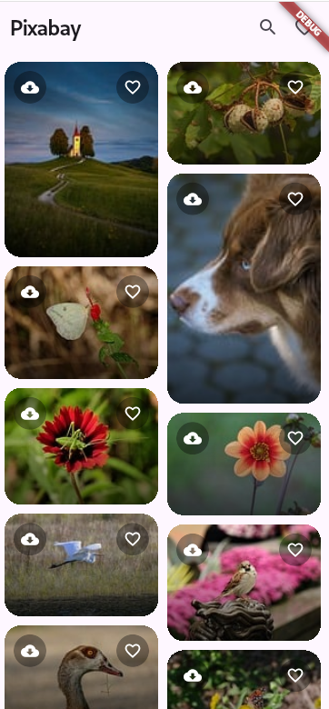

# Pixabay App

A Flutter app to browse and save images from [Pixabay](https://pixabay.com).

## Screenshots

| Main Screen | Favourites | Download |
|---|---|---|
|  |  |  |

## Features

- Browse photos in a masonry grid
- Infinite scroll pagination
- Download images to gallery
- Save favourites (persisted with SharedPreferences)

## Setup

1. Clone the repo and run `flutter pub get`

2. Create a `.env` file in the project root:
   ```
   PIXABAY_API_KEY=your_key_here
   ```
   Get a free key at [pixabay.com/api/docs](https://pixabay.com/api/docs/)

3. Run the app:
   ```bash
   flutter run
   ```

## Architecture

Uses **BLoC** for image fetching/pagination and a simple **FavouritesService** with SharedPreferences for local storage.

```
lib/
├── core/
│   ├── network/       # HTTP client, API routes
│   └── services/      # FavouritesService (SharedPreferences)
└── features/Images/
    ├── data/bloc/     # ImagesBloc, Events, States
    ├── domain/        # ImagesRepository
    └── presentation/  # Screens & widgets
```

## Dependencies

- `flutter_bloc` — state management
- `flutter_staggered_grid_view` — masonry layout
- `gal` — save images to gallery
- `shared_preferences` — persist favourites
- `flutter_dotenv` — load API key from `.env`
